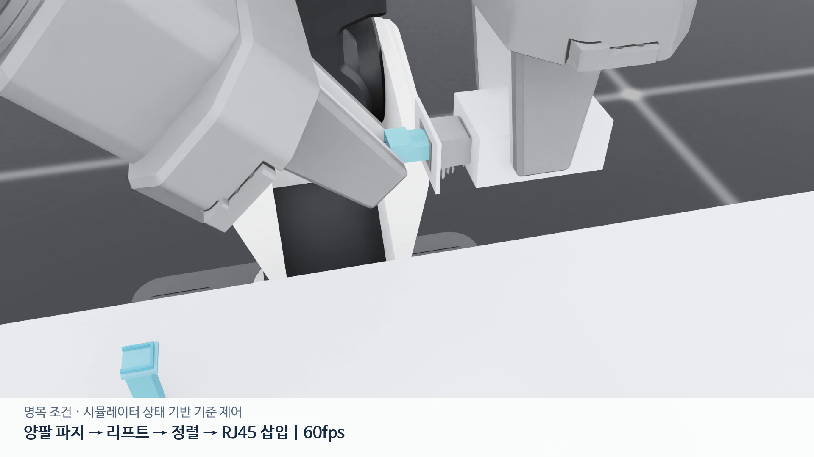

# RB-Y1 Assembly Lab

RB-Y1 양팔이 **왼손으로 작은 LAN 어댑터를 들고 오른손으로 RJ45 플러그를 끼우는** Isaac Sim 접촉 조립 실험이다. 어댑터가 고정되지 않아 한 손의 움직임이 다른 손의 정렬 오차에 영향을 준다. 실제 규격의 커넥터를 기본 RB gripper의 마찰 접촉으로 다루고, 기준 제어와 BC·PPO를 같은 평가 조건에서 비교한다.

[](docs/media/rj45/nominal40-pick-insert-60fps.mp4)

<sub>Isaac Sim 물리 실행 · 기준 제어의 파지·리프트·정렬·삽입 · 60 fps · [촬영 기록](docs/media/rj45/nominal40-pick-insert-60fps.json)</sub>

## 핵심 결과

수치는 모두 시뮬레이션 결과다. 정책 비교는 개발 조건의 결과이며 센서 성능, 실물 전이, 일반화 성능을 뜻하지 않는다.

| 항목 | 결과 | 근거 |
|---|---|---|
| 명목 삽입 | 기본 그리퍼의 마찰 접촉으로 두 부품을 15 mm 들어 올리고 약 12.3 mm 삽입한 상태를 0.4초 유지해 독립 판정 통과. 물리 120 Hz·240 Hz 두 실행 모두 같은 조건 통과 | [과제 문서](docs/rj45-task.md) |
| 병렬 처리량 | 단일 GPU에서 64·128·256환경 223 / 461 / 868 전이/초. update당 전이 수를 8,192개로 맞춰 비교 | [결과](docs/evidence/rj45-refinement-20261028/scale-results/README.md) |
| 물리 파지 선별 | 후보 20개를 평가해 train 8개·dev 2개·final 2개 선정. 정책 성능은 선정에 쓰지 않음 | [선정 결과](docs/evidence/rj45-demonstrations-20261028/generation-v2-bank-results/README.md) |
| 참조 시연 | 참조 제어기 시연 train 256회·dev 64회가 독립 평가 통과 | [데이터·학습 결과](docs/evidence/rj45-demonstrations-20261028/teacher-bc-results/README.md) |
| 정책 물리 비교 | 같은 개발 파지 2개와 보정 조건 64개에서 기준 제어 38/64, BC 12/64, PPO 200 update 세 실행 32/64·27/64·31/64 | [BC 진단](docs/evidence/rj45-demonstrations-20261028/bc-diagnostic/README.md) · [PPO 측정](docs/evidence/rj45-demonstrations-20261028/paired-first-attempt/README.md) |
| 실패 진단 | 선택된 BC 두 실행에서 자세 조건을 통과한 141개·31개 제어 시점이 모두 속도 조건을 넘음. 기준 제어의 같은 사례는 0.4초 안정 유지 후 성공 | [재현 분석](docs/evidence/rj45-stability-diagnosis-20261030/README.md) |
| 제어 방식 비교 | 고정 100 µm 보정 오차를 상쇄하는 유지 시험에서 기존 모드 x 오차 -99.14 µm, 팁 목표 모드 +1.67 µm | [비교 그래프](docs/media/rj45/controller-authority42-comparison.png) |
| 미사용 조건 비교 | 보정 오차 8조건에서 다중조건 PPO 3/8, 단일조건 PPO 2/8, 무보정 2/8. 1 seed 결과 | [평가·원본 계보](docs/evidence/rj45-multibias-20261031/README.md) · [영상](docs/media/rj45/publication-20261101-v3/comparison.mp4) |

## 과제와 판정 기준

- RJ45 장면은 TE 공식 잭 CAD와 플러그 도면 치수를 사용한다. 어댑터 외함과 픽업 받침은 설계 형상이고, 질량·마찰은 가정이다.
- 물체와 손 사이에 고정 조인트가 없고, 기본 그리퍼의 마찰 접촉으로 들어 올린다.
- 성공 목표는 깊이 12~13 mm, 횡오차 0.05 mm 이하, 각도 0.5° 이하, 접촉 하중 25 N 이하, 상대 선속도 5 mm/s 이하, 각속도 0.05 rad/s 이하를 0.4초 유지하는 것이다. 이 값은 프로젝트 평가 기준이며 제조사 조립 규격이 아니다.
- 저장한 원시 자세를 다시 계산해 런타임의 삽입 깊이·횡오차와 대조한다.

## 제어와 학습의 경계

정책은 삽입 단계의 오른손 6차원 목표 보정만 결정하고, 지지팔·삽입 진행·중단·복구는 스크립트가 담당한다. actor와 critic의 79차원 입력은 시뮬레이션 proxy이며 카메라 정책이나 실물 센서 결과가 아니다.

## 에셋과 데이터

- 공식 RB-Y1 M v1.2와 기본 RB gripper를 source revision·파일 SHA-256으로 고정한다.
- 원본 그리퍼 USD의 빠진 충돌 설정을 원본 손가락·손바닥 mesh의 convex hull로 보완한다. RJ45 실행은 기본 그리퍼 형상과 마찰 접촉을 사용하며, 물체와 손 사이 고정 조인트는 없다.
- RJ45 픽업 지그는 위가 열린 로케이터다. 플러그와 측면·전면 사이에 각각 0.15 mm의 초기 틈을 두어 미끄러짐과 회전을 줄이되, 위로 들어 올리는 동작은 막지 않는다. 공급사 부품이 아닌 프로젝트 설계 형상이다.
- 기존 toy 조립 부품은 치수·질량·마찰을 명시한 자유 강체다. 하우징의 구멍을 네 개의 벽 collider로 보존한다.
- NVIDIA AutoMate `00015`의 peg/socket, grasp, 분해 궤적 100개를 참고 데이터로 확보했다. Franka 시연을 RB-Y1 action 데이터로 바꾸어 표시하지 않는다.
- NVIDIA Simple Room은 실행 영상의 시각 배경으로 사용했으며, 충돌과 성공 판정에는 관여하지 않는다. 병렬 물리 학습의 필수 의존성으로도 두지 않는다. 에셋 목록과 사용 상태는 [자산 문서](docs/assets-and-data.md)에 있다.
- 데이터 기록기로 수집한 에피소드에는 관측·행동·관절·물체 자세·접촉·독립 평가와 출처를 저장한다. 단위 테스트의 합성 데이터는 학습 시연이 아니다.
- 기존 toy 기준선 HDF5는 3개 seed가 모두 독립 성공·유효 판정을 받았고, 학습 가능 train 2개와 격리한 eval 1개를 포함한다. 파일·episode hash와 원본 source archive 검증 결과의 정본은 [기준선 데이터 근거](docs/evidence/baseline-dataset.json)다. 기록 당시의 소스·설정·에셋 해시와 원본 소스 묶음을 보관한다. 이 데이터는 RJ45 정책 학습 근거로 사용하지 않는다.

다운로드한 바이너리 에셋은 Git에 포함하지 않는다. 기본 로봇·배경 에셋은 `configs/assets.json`, RJ45 CAD·도면은 `configs/rj45-assets.json`의 URL·크기·SHA-256으로 재현한다. 공식 잭 STEP은 KiCad 10의 `pcbnew` GLB export를 거쳐 정규화된 mesh로 변환하며, 변환 절차는 [RJ45 과제 문서](docs/rj45-task.md#재현)에 적었다.

## 로컬 검사

Python 3.11 환경에서 실행한다. 이 단계는 GPU 없이 가능하다.

```bash
cd "$HOME/rby1-assembly-lab"
uv venv --python 3.11 .venv
uv pip install --python .venv/bin/python -e '.[assets]'
uv pip install --python .venv/bin/python pytest==9.2.0
uv pip install --python .venv/bin/python --index-url https://download.pytorch.org/whl/cpu 'torch==2.7.0+cpu'
.venv/bin/python scripts/fetch_assets.py
.venv/bin/python scripts/build_scene.py
.venv/bin/python scripts/audit_assets.py --generated --output artifacts/asset-audit.json
PYTHONPATH=src .venv/bin/python -m pytest -q tests
```

`assets/generated/scene.usda`는 정적 장면이다. USD 생성이나 단위 테스트 통과는 물리 과제 성공을 뜻하지 않는다.

## Isaac 실행

RTX 렌더링을 지원하는 GPU에서 Isaac Sim 5.1.0, Isaac Lab 2.3.0, Python 3.11로 실행한다. 기존 학습 경로는 RSL-RL 3.0.1, PPO/SAC 공통 비교 경로는 skrl 2.1.0을 사용하며 두 경로의 결과를 섞어 비교하지 않는다. 설치·실행 절차는 [실행 문서](docs/brev-run.md)에 있다.

## 문서

- [실험 기록](docs/experiment-log.md): 설정별 결과, 실패 측정, 검증 범위
- [RJ45 과제 문서](docs/rj45-task.md): 형상 출처, 제어 단계, 재현 절차
- [실험 계약](docs/experiment-design.md): 기준 제어 비교, 데이터 분리, 성공 판정
- [강화학습 연구·실험](docs/rj45-rl-research.md): 관측·보상·학습 설정 비교
- [자산 문서](docs/assets-and-data.md): 에셋 출처와 사용 범위
