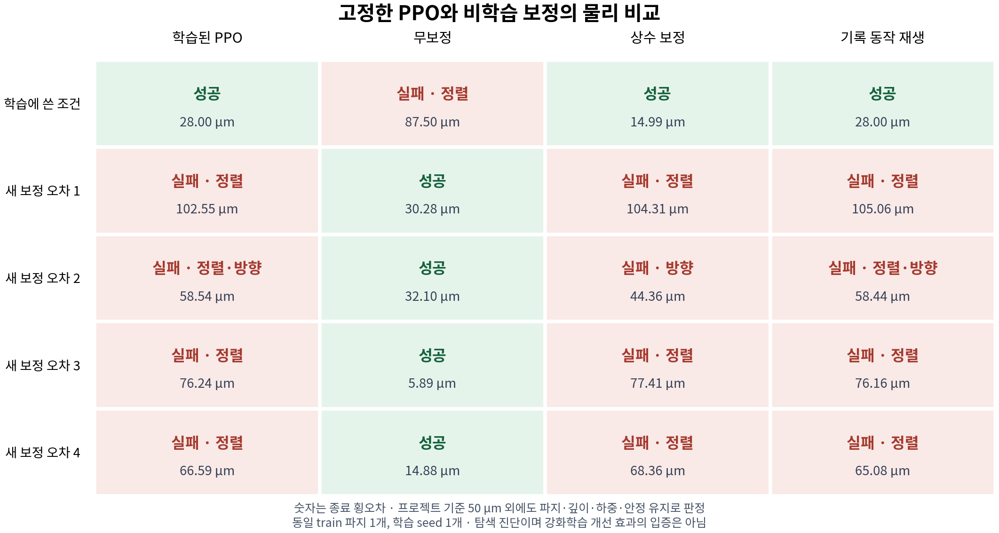

# 고정 PPO와 상수·동작 재생 대조

기존 PPO32의 성공이 실행 중 관측에 따른 보정을 필요로 하는지 확인하는 물리 대조 실험이다. 학습을 추가하지 않고 최종 체크포인트를 고정했다. 같은 train 파지에서 학습에 사용한 보정 오차 1개와 이 정책이 학습에 사용하지 않은 보정 오차 4개를 비교한다. dev/final 파지는 열지 않았다.

## 결과

**학습 조건에서는 PPO·상수·재생 보정이 모두 성공했지만, 새 보정 오차 네 개에서는 모두 실패했다. 무보정 기준은 새 네 조건에서 모두 성공했다.**

| 방법 | 학습에 쓴 조건 1개 | 새 보정 오차 4개 | 전체 5개 |
| --- | ---: | ---: | ---: |
| 학습된 PPO | 1/1 | 0/4 | 1/5 |
| 무보정 | 0/1 | 4/4 | 4/5 |
| 상수 보정 | 1/1 | 0/4 | 1/5 |
| 기록 동작 재생 | 1/1 | 0/4 | 1/5 |

숫자는 성공 횟수다. 20회 모두 유효 판정을 받았으며 성공 7회·실패 13회였다. 새 조건에서 PPO만 성공한 사례는 0개, 무보정만 성공한 사례는 4개다. 상수·재생과 PPO는 새 네 조건에서 모두 함께 실패했다. [집계](summary.json), [조건별 원문](results-report.json), [전체 적용 행동 감사](audit.json), [짝지은 성공·역전 실패 목록](comparison-data.json)을 보존한다.



학습 조건의 종료 횡오차는 PPO 28.00 µm, 상수 14.99 µm, 재생 28.00 µm였다. 한 조건의 PPO 성공만으로 관측에 따른 피드백 학습을 입증할 수 없다. 새 네 조건에서는 무보정 대비 성능이 낮았으므로 이번 정책을 개선 후보로 승격하지 않는다. 이는 한 파지·한 학습 seed의 탐색 진단이며 PPO 알고리즘 전체의 한계나 다른 조건의 성공률을 추정한 결과가 아니다.

실패한 실행의 terminal 판정은 횡방향 정렬 또는 방향 오차와 안정 유지 조건에서 미달했다. 파지·깊이·하중·금지 접촉 조건은 terminal 판정에서 통과했다. 특히 새 조건 2의 상수 보정은 횡오차 44.36 µm였지만 방향 조건에서 실패했다. 그림의 숫자 하나만으로 성공을 판단하지 않는다.

다음 비교는 같은 train 파지를 유지하면서 학습 보정 오차의 분포를 넓히는 것이다. 관측·보상·행동 범위를 함께 바꾸지 않고 단일 조건 학습과 비교한다. 이번 네 조건은 이미 진단에 사용했으므로 이후 미사용 평가 조건으로 재사용하지 않는다. [후속 계획](../../rj45-rl-contribution-plan.md)의 G3에 학습·평가 분리와 여러 학습 seed의 검증 순서를 반영했다.

## 비교 방법

| 방법 | 삽입 단계의 오른손 잔차 행동 |
| --- | --- |
| 학습된 PPO `standard79` | 매 제어 시점의 79D 관측으로 6D 보정을 계산 |
| 무보정 `zero` | 항상 0 |
| 상수 보정 `mean_constant` | 기존 PPO 성공 기록의 유효 행동 364개를 평균해 유지 |
| 기록 동작 재생 `open_loop_playback` | 같은 기록의 유효 행동 364개를 순서대로 사용하고 이후 마지막 값을 유지 |

상수와 재생 동작은 학습된 PPO의 기록에서 얻었다. 학습 없이 같은 값을 찾을 수 있음을 입증하는 비교는 아니다. 실행 중 상태를 읽어 잔차를 바꾸는 일이 필요한지 구분하는 대조다. 재생은 잔차 행동열에만 적용하며, 기존 제어기의 접촉·자세 피드백과 단계 전환은 유지한다. 이를 로봇 전체의 개루프 제어로 표현하지 않는다.

## 고정한 조건

- 체크포인트: 기존 `standard79`의 사전 지정 final32. 추가 학습·체크포인트 선택 없음.
- 파지: `rj45-train-02` 하나. 검증된 held 상태에서 초기화하며 테이블 픽업 전체를 새로 평가하는 실험이 아니다.
- actor 79D, critic 92D 환경을 네 방법에 공통 사용. 정책 입력은 시뮬레이션 추정 상태이며 RGB 영상이나 실측 센서값이 아니다.
- 바꾸는 값은 에피소드 동안 일정하게 유지되는 추정 좌표계의 보정 오차다. 물체 위치·형상·마찰·외력을 함께 바꾼 시험이나 실측 카메라 보정 시험이 아니다. 새 네 조건도 원래 보정 오차 범위에서 뽑았다.
- 물리 240 Hz, 제어 30 Hz, 환경 1개에서 20회를 순차 실행. case별 비교 순서는 회전하며 5개 case라 완전한 균형 설계는 아니다.
- 두 손의 물리 마찰 파지는 유지한다. 왼손 지지, 삽입 깊이 진행, 단계 전환, 하중에 따른 중단·후퇴는 고정 스크립트다. 학습된 양팔 전체 제어·학습된 복구로 표시하지 않는다.
- 성공은 원래 strict 판정을 유지한다. 프로젝트 횡오차 기준 50 µm뿐 아니라 깊이·방향·파지·하중·금지 접촉과 0.4초 안정 유지를 함께 검사한다. 50 µm는 제조사 조립 규격의 보증값이 아니다.

[실행 전 계획](admission-plan.json), [동결 계약](contract.json), [실행 입장권](execution-admission.json)에 seed·순서·예산·판정 범위를 고정했다. CUDA 생성기로 다섯 보정값을 첫 평가 전에 저장하고, 매 reset의 실제 값과 일치하는지 확인한다. 같은 case의 네 방법은 최초 79D 관측, RNG, 파지와 보정 오차를 일치시킨다. 조건이나 체크포인트를 성과에 따라 교체하지 않는다.

환경은 한 번 생성해 재사용한다. 원문 보고서의 `evaluation_rng.seeded.physics_seed_unchanged`는 실행기에 넘긴 case base-seed를 보존한 계보 필드이며, PhysX 재시드 증거가 아니다. Python·NumPy·Torch의 평가 RNG는 고정값으로 재설정하지만 PhysX 장면을 case마다 새로 생성하지 않는다. 이번 비교는 여러 PhysX seed의 반복 시험이 아니다. [실행 범위 설명](execution-scope.json)에 이 구분을 남겼으며 원문 보고서는 수정하지 않는다.

## 첫 실행의 무효 처리와 수정

첫 실행은 PPO 평가 뒤 무보정 평가의 행동 횟수 검사에서 중단됐다. 현재 입력이 유효한데도 이전 스텝의 유효 입력 누적 횟수가 0이면 재생 시계를 진행하지 않는 오류였다. 환경은 실행 후 누적 횟수를 증가시키므로 첫 유효 행동 하나가 누락됐다. 첫 실행의 보고서·두 trace·원래 패킷·종료 코드는 [무효 실행 폴더](invalid-attempt-a/)에 보존한다. 부분 PPO 성공과 무보정 기록은 새 20회 결과에 합산하지 않는다.

수정은 현재 입력의 유효성·정책 활성·준비 완료 검사를 유지하고, 이전 누적 횟수 조건만 제거했다. 첫 유효 입력의 누적 횟수가 0인 회귀 검사를 추가했다. 물리·행동 한도·보상·정책·seed·성공 기준은 바꾸지 않았다. [수정 실행 입장권](repair-admission.json)에 새 해시와 원래 무효 기록의 연결을 남겼다. 같은 $6 예약을 공유하고 원래 정지 시각을 연장하지 않았다.

## 자료 재확인

공개 패킷은 실행 소스·원래 프로토콜·행동 출처 trace와 계약을 포함한다. 계정 청구 내역과 체크포인트 바이너리는 공개하지 않고 SHA-256으로 연결한다. $6는 두 시도의 추가 예약 상한이며 실제 청구액이 아니다.

```bash
cd "$HOME/rby1-assembly-lab"
python3 docs/evidence/rj45-frozen-ablation-20261031/audit_results.py
python3 docs/evidence/rj45-frozen-ablation-20261031/plot_results.py
```

감사기는 Python 표준 라이브러리로 결과·trace·적용 행동·관측과 실행 계보를 검사한다. PPO를 다시 추론하거나 PhysX를 재실행하는 검사는 아니다. 그래프 생성에는 matplotlib이 필요하다. GPU 재실행은 동결 런타임·에셋·해당 체크포인트가 필요하며, 과거 deadline을 새 실행에 재사용하지 않는다.

## 검증과 종료

CPU 검사 779개·하위 검사 307개가 통과했다. 감사기는 20개 episode와 원문 report의 동일성, gzip 해제 trace SHA, 실제 적용된 상수·재생 행동, 재생 끝값 유지, 동일 case의 최초 관측·RNG·보정값, actor 79D/critic 92D와 원래 체크포인트·소스 연결을 검사했다. [변조 검사](audit-validation.json)는 정상 샘플을 통과시키고 보고서 불일치·terminal 모순·관측 차원 변경·알 수 없는 event·누락된 active 플래그를 거절했다.

실행은 2026-10-31 06:20:02–06:59:53 UTC에 완료됐다. [회수 기록](recovery.json)의 13,024,453-byte 원본 묶음 SHA를 대조한 뒤 L40S 한 대를 정지했다. 새 inventory에서 exact ID의 `STOPPED`, 원격 작업 프로세스와 GPU compute process가 없는 상태, 이번 타이머·서비스의 비활성 상태를 확인했다. [종료 기록](closure.json)에 남겼다. 기존 볼륨은 보존했고 새 인스턴스 생성과 삭제는 하지 않았다.
