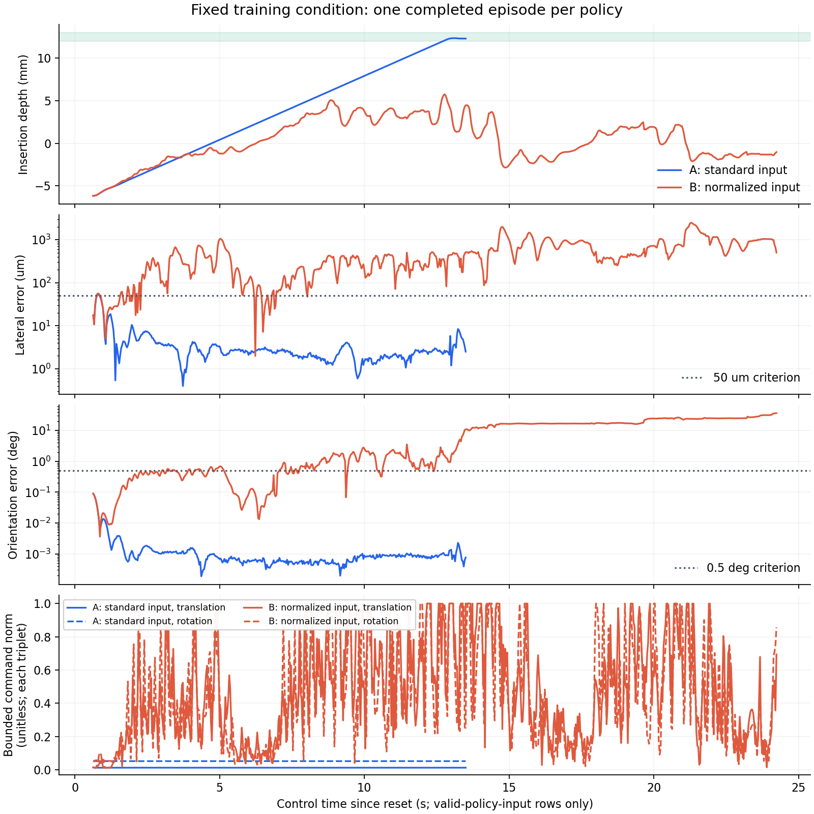

# 고정 train 조건의 PhysX 폐루프 진단

입력을 표준화한 B는 같은 궤적의 행동 예측 오차가 A보다 약 84.1% 작았지만, 물리 제어에서는 실패했다. A는 삽입과 안정 유지에 성공했다. 오프라인 예측 오차 감소를 제어 성능 개선으로 승격하지 않는다.

## 완료된 두 실행

| 항목 | A: 기존 입력 | B: train 통계로 표준화한 입력 |
| --- | ---: | ---: |
| 최종 판정 | `valid_success` | `valid_failure` |
| 종료 이유 | 독립 성공 | `episode_timeout` |
| 활성 에피소드 시각 | 13.267 s | 24.000 s |
| 마지막 삽입 깊이 | 12.295 mm | -1.026 mm |
| 마지막 횡오차 | 2.506 µm | 503.891 µm |
| 마지막 방향 오차 | 0.000762° | 36.615° |
| 접촉 하중 proxy 최댓값 | 3.778 N | 7.117 N |
| 저장한 제어 step | 405 | 727 |
| 유효 정책 입력 step | 387 | 709 |

깊이가 음수이면 플러그 팁이 소켓 입구 바깥에 있다. 하중은 PhysX의 파지·삽입 접촉 proxy이며 손목 F/T 센서 측정값이 아니다. 두 실행 모두 양손 파지를 유지했고 금지 접촉은 검출되지 않았다. B는 정렬과 삽입 조건을 만족하지 못했다.

한 train 파지와 한 보정 조건에서 정책당 한 episode를 완료한 진단이다. 성공률·정규화의 인과 효과·일반화·PPO의 추가 기여를 입증하는 실험이 아니다. A와 B는 395행의 같은 궤적으로 학습한 진단용 actor이며 본실험 BC에 주입하지 않는다.



그래프는 `policy_input_valid=True`인 행만 표시한다. 전체 초기화 행은 압축 trace에 보존했다. 가로축은 reset 이후 제어 시각이므로 표의 활성 에피소드 시각과 초기화 구간만큼 차이가 있다. A의 선은 성공 시점에서 끝난다. 적용 명령은 평행이동·회전 각각의 정규화된 3축 벡터 크기이며 물리 단위가 없다.

## 같은 조건인지 확인한 항목

- `cfg.seed=20261120`, env 0, episode 1, `rj45-train-02`, 보정 조건 seed `66384140`을 고정했다.
- 원본 train bank 8개의 artifact·명목 report·trace·설정·생성 소스 해시를 실행 전후 검증했다. dev/final artifact는 열지 않았다.
- A/B의 공통 protocol과 bank provenance, 첫 79D 관측 해시가 일치했다. 각 체크포인트와 정규화 배열을 검증했고, 서버의 395행 예측 배열 해시도 로컬과 일치했다.
- 물리는 240 Hz, 제어는 30 Hz, 활성 horizon은 24초다. 초기 파지 안정화의 별도 상한은 1초다.
- 왼팔 지지와 삽입 진행·중단·복구는 기존 supervisor가 담당한다. actor는 오른손의 6D 팁 목표 보정만 출력한다. 정답 물체 자세와 9개 물리 샘플은 평가에만 사용한다.

생성 당시 물리 소스와 현재 main의 초기화 코드를 섞지 않도록 `104721acf2222c1cfe8ec86cd030f5116a4fef93`의 별도 runtime snapshot을 사용했다. 원본 bank와 물리 소스·설정·에셋은 수정하지 않았다. 새 어댑터만 현재 저장소에서 실행했다.

## 실패 시계열에서 관찰한 것

B의 이전 명령 관측이 0.733초에 학습 범위를 벗어났다. 이때 관측 61열의 원래 값은 `-0.02684`, 해당 train 범위는 `[-0.01725, 0]`이었다. 이후 B의 명령이 커졌고 물리 정렬 오차도 증가했다. B의 평행이동 보정은 1.5 mm, 회전 보정은 1.5°의 기존 한계까지 도달했다. 두 종류의 단위를 합쳐 길이로 해석하지 않는다.

이는 이전 명령 피드백의 증폭이나 방문 상태 분포 차이를 조사할 근거다. 한 조건의 두 완성 정책을 비교한 결과여서 입력 통계의 증폭, 학습된 가중치와 이전 명령의 되먹임 중 어떤 기전이 실패를 만들었는지는 분리하지 못했다. B의 상수 입력 21열은 실제 추론에서 0으로 처리되므로 그 열의 원시 변화를 입력 증폭의 근거로 세지 않았다. 계산 결과와 입력 해시는 [분포 이탈 분석](drift-analysis.json)에 있다.

다음 단계는 학습 정책이 방문한 상태에서 참조 제어기 명령을 같은 시각에 기록하는 수집 경로다. 상태 비변경·관측 시각·정답 정보의 정책 입력 누출 방지 검사를 먼저 통과시킨다. 데이터 보강의 폐루프 효과를 확인한 뒤 BC-only와 BC 초기화 PPO의 비교로 진행한다. 현 단계에서 학습 횟수만 늘리거나 B를 본실험에 승격하지 않는다.

## 기록기 검증과 무효 실행

| 실행 | 무효 사유 | 처리 |
| --- | --- | --- |
| run1 A/B | 범용 기록기가 양손 간 접촉을 포함한 결합 하중 source를 지원하지 않음 | 실제 접촉 성분과 collision filter를 검증하는 어댑터로 수정 |
| run2 A/B | 초기화 종료 시 누적값이 지워진 후의 env 값과 이전 step의 snapshot을 혼합 | 모든 step의 동적 데이터를 하나의 pre-reset snapshot에서 읽도록 수정 |
| run3 A/B | 범용 y축 기하 계산이 소켓 입구의 z 오프셋 0.5075 mm를 누락 | frozen task의 전체 XYZ·quaternion으로 SE(3) 재계산 |
| run4 B | 물리 trace 완료 후 최종 파일 재검증 중 240초 wall-clock 제한 도달 | 같은 코드·모델·protocol로 B만 420초 상한에서 재실행 |

채택한 결과는 run4 A와 run5 B다. run4 B와 run5 B의 전체 물리 trace 해시는 정확히 일치했다. 이 재실행을 독립 표본 두 개로 세지 않는다. 무효 실행·시간 제한·수정 전 protocol의 해시와 이유는 [결과 정본](result.json)에 보존했다.

독립 판정은 전체 mating frame으로 계산한 끝점 기하와 물리 샘플 9개의 깊이·횡오차·각도·상대 속도를 검사한다. 성공에는 12~13 mm 깊이, 50 µm 횡오차, 0.5° 방향 오차와 기존 속도·0.4초 유지 조건을 적용한다. 50 µm는 프로젝트의 시뮬레이션 기준이며 제조사 규격이나 실물 센서 정확도를 뜻하지 않는다. 물리 샘플의 전체 배열은 실행 중 검사했으나 현재 trace에는 저장하지 않았다. 이 기록으로 사후 재계산할 수 있는 범위는 79D 관측·명령·끝점 오차·하중이다.

## 파일과 재현

- [최종 protocol](protocol-v4.json)과 [결과·해시 정본](result.json)
- [A report](a_standard_input.report.json), [B report](b_normalized_input.report.json)
- [A 전체 trace](a_standard_input.trace.jsonl.gz), [B 전체 trace](b_normalized_input.trace.jsonl.gz)
- [그래프 재생성 코드](plot_traces.py), [SVG](physics-comparison.svg)

그래프는 Python·NumPy·Matplotlib 환경에서 다음 명령으로 다시 생성한다.

```bash
cd "$HOME/rby1-assembly-lab"
python3 docs/evidence/rj45-g2-physics-20261031/plot_traces.py
```

물리 재실행에는 Git 비추적 bank·원본 report/trace·에셋·NPZ·체크포인트가 필요하다. 이 자료는 로컬 `artifacts/cloud/rj45-g2-new-cloud-20261031/`와 새 서버의 `$HOME/workspace/rby1-g2-20261031/`에 보존했다. 설치 절차는 [Brev 실행 문서](../../brev-run.md)를 따른다. 저장소만 clone한 상태에서 전체 물리 실험이 재현된다고 보장하지 않는다.

코드 작성과 리뷰를 분리했고 최종 어댑터 리뷰를 통과했다. 로컬 `tests` 검사 결과는 709 passed·292 subtests passed다. Brev L40S 1장, Python 3.11.15, Isaac Sim 5.1.0, Isaac Lab 2.3.0, Torch 2.7.0+cu128에서 실행했다. 보존한 비용 예약은 실제 청구액이 아니며 프로젝트의 700 USD 한도를 늘리지 않았다.
