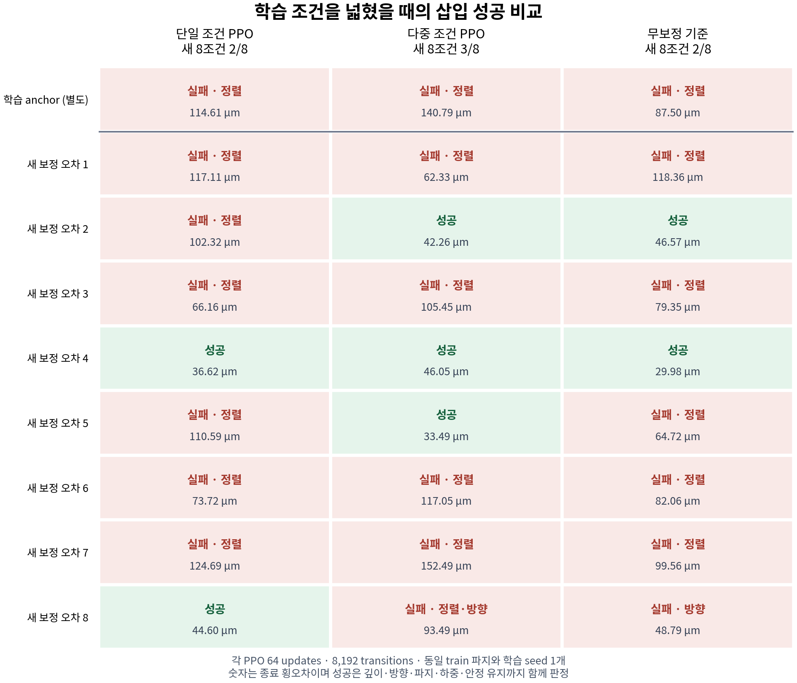
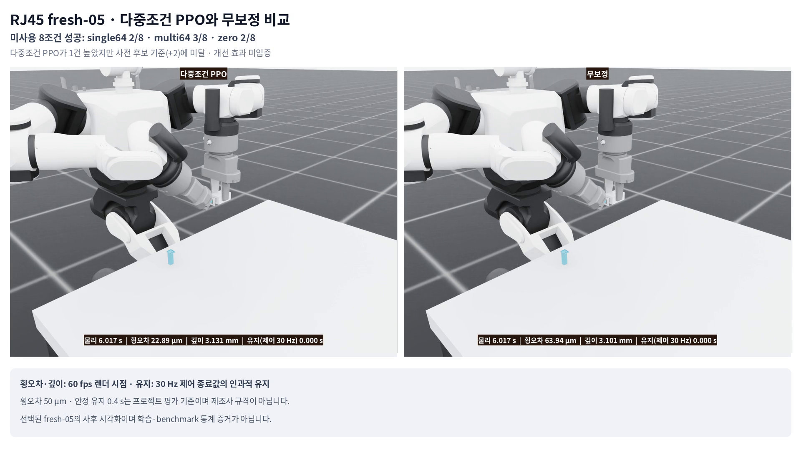

# RJ45 단일·다중 보정 오차 PPO 비교

## 결과

같은 train 파지에서 한 보정 오차만 학습한 `single64`와 네 보정 오차를 순환한 `multi64`를 비교했다. 두 학습은 각각 64 updates·8,192 transitions를 사용했다. 미사용 8조건의 strict 성공은 `single64` 2/8, `multi64` 3/8, 무보정 `zero` 2/8이었다.

`multi64`는 `single64`보다 1건 높았지만, 실행 전에 정한 후속 다중 seed 후보 기준인 2건 이상 차이를 충족하지 못했다. 한 학습 seed의 결과이므로 학습 분포 변경의 효과, 일반화, 최종 정책을 입증하지 않는다. [사후 감사](audit.json)는 27회 평가가 모두 유효하고 비교 가능한 조건임을 확인했지만, 후보 기준 통과를 뜻하지 않는다.



## 실험 설계와 재현 조건

| 항목 | single64 | multi64 | 공통 조건 |
| --- | --- | --- | --- |
| 학습 보정 오차 pool | anchor 1개 | anchor·train-02·train-03·train-04 4개 | 같은 train 파지 `rj45-train-02` |
| 학습량 | 64 updates·8,192 transitions | 64 updates·8,192 transitions | update당 128 transitions, final64만 평가 가능 |
| 정책 권한 | 오른팔 6D 팁 목표 잔차 | 오른팔 6D 팁 목표 잔차 | 왼팔 지지·삽입 진행·중단·복구는 스크립트 |
| 관측 | actor 79D | actor 79D | critic 92D, 시뮬레이션 상태 proxy |
| 초기화와 난수 | 동일 | 동일 | actor·critic·optimizer·학습 RNG·첫 anchor 79D 해시 일치 |
| 물리 | 동일 | 동일 | PhysX seed `20261128`, train grasp 1 |

참조 제어기는 anchor와 세 학습 조건의 사전 검사에서 4/4 strict 성공했다. 두 PPO의 학습 전이 수는 모두 8,192개다. 완료 episode는 각각 11개이며 각 길이는 727 transitions, 마지막 195 transitions는 미완료 tail이다. `multi64`의 조건별 전이는 anchor·train-02·train-03이 각각 2,181개, train-04가 1,649개다. 마지막 episode 도중 고정 전이 예산이 끝난 결과이며 균등 노출을 주장하지 않는다.

50 µm 횡오차는 이 프로젝트의 평가 기준이며 제조사 조립 규격이 아니다. final 파지 두 개는 열지 않았다. actor의 79D 입력과 접촉 신호는 시뮬레이션 proxy이므로 카메라 정책, 실물 센서 성능 또는 sim-to-real 결과를 뜻하지 않는다.

재현과 감사의 정본은 다음 파일에 있다.

- [실험 계약](contract.json)
- [참조 제어기 사전 검사](preflight-report.json)
- [single64 학습 보고서](train-single-report.json)
- [multi64 학습 보고서](train-multi-report.json)
- [27회 평가 보고서](evaluate-report.json)
- [사후 감사](audit.json)
- [학습 진단](training-diagnostics.json)
- [공개 파일 해시 목록](file-manifest.json)

## 평가 27회

평가는 anchor 1조건과 미사용 8조건에 `single64`, `multi64`, `zero`를 각각 한 번씩 적용했다. 모든 방법은 사례마다 같은 평가 RNG, 초기 79D 관측, 보정 오차, 파지와 strict 판정을 사용했다. 원본 trace 해시와 판정은 [평가 보고서](evaluate-report.json), 집계용 행은 [비교 데이터](comparison-data.json)에 있다.

| 평가 범위 | single64 | multi64 | zero |
| --- | ---: | ---: | ---: |
| anchor | 0/1 | 0/1 | 0/1 |
| fresh-01~08 | 2/8 | 3/8 | 2/8 |
| 전체 9조건 | 2/9 | 3/9 | 2/9 |

미사용 8조건의 짝지은 비교는 `multi64` 대 `single64`가 2승·1패·5무, `multi64` 대 `zero`가 1승·0패·7무였다. 사례별 성공과 최종 횡오차는 위 그래프와 [비교 데이터](comparison-data.json)에서 확인할 수 있다.

## 사전 후보 기준과 판정

후속 다중 seed 후보는 아래 세 조건을 모두 만족해야 했다.

1. `multi64` 성공 수가 `single64`보다 2건 이상 많다.
2. `multi64` 성공 수가 `zero`보다 많다.
3. `zero` 성공·`multi64` 실패 역전이 1건 이하다.

실제 차이는 `3 - 2 = 1`건이어서 첫 조건에 미달했다. `zero` 성공·`multi64` 실패 역전은 0건이지만, 일부 조건만 통과한 결과로 후보를 승격하지 않았다. `followup_multiseed_candidate=false`, `effect_proven=false`를 유지한다.

이전 단일조건 PPO32가 anchor에서 성공했고 이번 PPO64 두 군이 anchor에서 실패한 사실은 학습량 증가의 효과를 보여주는 통제 비교가 아니다. 이전 실행과 이번 실행은 같은 실험에서 update 수만 바꾼 두 군이 아니므로, 64 updates가 32 updates보다 나쁘거나 학습량이 성공을 보장한다고 해석하지 않는다.

## 검증

- 참조 제어기 사전 검사 4/4 strict 성공
- 학습당 64 updates·8,192 transitions와 finite update 기록 확인
- 두 학습의 actor·critic·optimizer·RNG·첫 anchor 79D 동일성 확인
- 평가 27/27 valid, 조건별 초기 관측·RNG·bias·파지 pairing 확인
- 압축 trace와 복원 byte SHA-256, checkpoint 최종64 계보 확인
- strict 판정과 terminal criteria의 모순 여부 검사

[사후 감사](audit.json)의 `status=pass`와 `ranking_allowed=true`는 위 입력과 집계가 비교에 사용할 수 있을 만큼 완전하다는 뜻이다. 강화학습 효과 판정은 별도이며 `effect_proven=false`다.

## 보상·탐색 진단과 한계

[학습 진단](training-diagnostics.json)에 기록된 dense reward의 횡오차 scale은 500 µm다. 초기 Gaussian command 분포의 명목 병진 표준편차는 150 µm이고 strict 횡오차 기준은 50 µm다. 150 µm는 실제 팁 오차 측정값이 아니라 정규화 행동을 물리 명령으로 바꾼 분포의 scale이다.

이 차이는 다음 실험 가설을 세우는 근거일 뿐, 실패의 인과 원인을 확정하지 않는다. 이번 실행에서는 보상·탐색 hyperparameter를 바꾸지 않았다. 다음 단일 변경 후보는 초기 탐색 표준편차와 감쇠 방식의 사전등록 대조다. 초기화, 학습 조건, 보상, 행동 한도, 전이 예산과 final64 선택을 유지한 채 한 요소만 바꾸는 설계를 먼저 검토하며, 이 문서 시점에는 실행하지 않았다.

참조 제어기의 4/4 사전 검사는 학습 pool에 한정된다. 미사용 8조건에는 참조 제어기를 실행하지 않았으므로, 세 방법이 모두 실패한 fresh-01·03·06·07의 해결 가능성은 확인하지 않았다. 이 실패들을 학습 알고리즘만의 문제로 단정하지 않는다.

현재 결과의 범위는 한 학습 seed, 한 train 파지, 8개의 미사용 보정 오차다. 지지팔은 학습하지 않았고 오른팔의 6D 잔차만 학습했다. final 파지·카메라 입력·실물 부품·실물 센서·sim-to-real은 평가하지 않았다.

## 무효 첫 실행과 수정

[첫 실행](invalid-attempt-a/README.md)은 참조 제어기 사전 검사 4/4 뒤 첫 학습 스텝의 기록 경로에서 종료됐다. 원시 환경에 없는 `get_observations()`를 호출한 것이 관찰된 오류다. PPO update와 학습 transition은 모두 0개였으며, 이 실행의 결과는 수정 실행에 합산하지 않았다.

수정 실행 B에서는 정책에 반환된 79D 관측 캐시를 step 전에 복제해 해당 행동의 입력을 기록하고 terminal snapshot과 대조했다. 물리·보상·초기화 seed·전이 예산·평가 조건은 유지했다. 무효 실행의 보고서와 trace는 [별도 디렉터리](invalid-attempt-a/)에 보존한다.

## 실제 물리 재생 영상

전체 평가를 마친 뒤 fresh-05를 설명용 사례로 골라 두 방법을 새 물리 환경에서 각각 한 번 촬영했다. 첫 eligible 79D 입력과 성공·실패 분류가 원 평가와 일치했으며 성과에 따른 재촬영은 하지 않았다. 이 영상은 학습 기록이나 평가 통계를 대체하지 않는다.

| 방법 | 원본 영상 | 프레임·길이 | 재생 종료 횡오차 | 판정 |
| --- | --- | --- | ---: | --- |
| multi64 | [성공 원본](../../media/rj45/multibias/raw/fresh05-multi64.mp4) | 760 frames·12.667 s·60 fps | 33.51 µm | 성공 |
| zero | [실패 원본](../../media/rj45/multibias/raw/fresh05-zero.mp4) | 1,454 frames·24.233 s·60 fps | 64.71 µm | 횡오차 초과·안정 유지 미충족·시간 초과 |

물리는 240 Hz, 제어는 30 Hz이며 4 physics steps마다 실제 프레임을 기록했다. 원본 프레임을 보간하거나 복제하지 않았다. 영상에는 파지 초기화 0.233 s가 포함되므로 episode 종료 시각과 MP4 길이는 다르다. 카메라는 관찰용 뷰어이며 actor의 RGB 입력이 아니다. [재생 보고서·프레임 기록](media/)과 [미디어 회수 계보](media/recovery.json)에 실제 fresh replay 수치와 해시를 보존한다. 새 재생의 미세한 수치 차이는 원 평가의 수치로 덮어쓰지 않았다.

[실패 사유와 측정값을 함께 표시한 60fps 비교 영상](../../media/rj45/multibias/fresh05-multibias-comparison.mp4) · [합성 계보](../../media/rj45/multibias/fresh05-multibias-comparison-provenance.json)



비교 영상은 1,574 frames·26.233 s·1920×1080·60 fps다. 두 원본은 같은 시작 시각에 배치하고, 한쪽 촬영이 끝나면 해당 화면을 결과 카드로 바꿨다. 원본이 모두 끝난 뒤 2초도 결과 카드이며 로봇 동작 프레임을 반복하지 않았다. 횡오차·깊이는 각 60fps 렌더 시점의 값이고, 안정 유지 시간은 완료된 30Hz 제어 스텝의 값만 갱신해 다음 완료 시점까지 유지한다. 최초 제어 완료 전 값은 `—`다.

## CPU 재현

원본 평가의 감사·그래프·보상 진단은 GPU 없이 실행할 수 있다.

```bash
cd "$HOME/rby1-assembly-lab"
python3 docs/evidence/rj45-multibias-20261031/audit_results.py
python3 docs/evidence/rj45-multibias-20261031/plot_results.py
python3 docs/evidence/rj45-multibias-20261031/diagnose_training.py
```

비교 영상은 `build_media.py`로 재생성한다. `ffmpeg`·`ffprobe`, Pillow, 코드에 기록한 Noto CJK 폰트가 필요하다. 공개 파일로 입력 폴더를 복원한 뒤 새 출력 폴더를 지정한다. 기존 산출물을 덮어쓰지 않는다.

```bash
cd "$HOME/rby1-assembly-lab"
python3 - <<'PYCODE'
from pathlib import Path
import gzip, shutil
source = Path('docs/evidence/rj45-multibias-20261031/media')
target = Path('artifacts/rj45-multibias-public-media-inputs')
target.mkdir(parents=True, exist_ok=False)
shutil.copyfile(source / 'recovery-files.json', target / 'recovery-files.json')
for mode in ['multi64', 'zero']:
    name = f'fresh05-{mode}'
    shutil.copyfile(Path('docs/media/rj45/multibias/raw') / (name + '.mp4'), target / (name + '.mp4'))
    for suffix in ['.mp4.metadata.json', '.mp4.evidence.json', '-report.json']:
        shutil.copyfile(source / (name + suffix), target / (name + suffix))
    (target / (name + '.mp4.frames.jsonl')).write_bytes(gzip.decompress((source / (name + '.mp4.frames.jsonl.gz')).read_bytes()))
PYCODE
python3 docs/evidence/rj45-multibias-20261031/build_media.py \
  --media-root artifacts/rj45-multibias-public-media-inputs \
  --output-dir artifacts/rj45-multibias-presentation-rebuild \
  --audit docs/evidence/rj45-multibias-20261031/audit.json
```

## 실행 종료

[종료 확인](closure.json)은 지정한 Brev 한 대의 fresh CLI 상태 `STOPPED`, 원본 회수 전 소유 프로세스·GPU 작업 0, 정확한 자동 종료 timer/service의 `not-found`·`inactive`·`dead`를 기록한다. 원래 종료 시각을 연장하지 않았고 다른 인스턴스·볼륨은 변경하지 않았다. 보존한 볼륨의 저장 비용은 정지 후에도 별도다.

## 데이터 계보

원격 회수 archive는 `50,064,786` bytes이며 SHA-256은 `a3545e26e3a768e4d3667bca78de7029fe9363e4f6c0a90f1df4b2d8a7ff7cff`다. [회수 기록](recovery.json)의 archive 메타데이터와 실제 tar 목록은 파일 122개로 일치한다. 공개 복사본은 [파일 manifest](file-manifest.json)에서 경로별 크기와 SHA-256을 대조한다.

원본 학습 checkpoint 바이너리는 회수 archive에 보존하고 공개 보고서에는 SHA-256을 남겼다. 실행기·원래 protocol·runtime manifest·관측 adapter·평가 helper의 source SHA도 계약과 감사 보고서에 고정했다.
