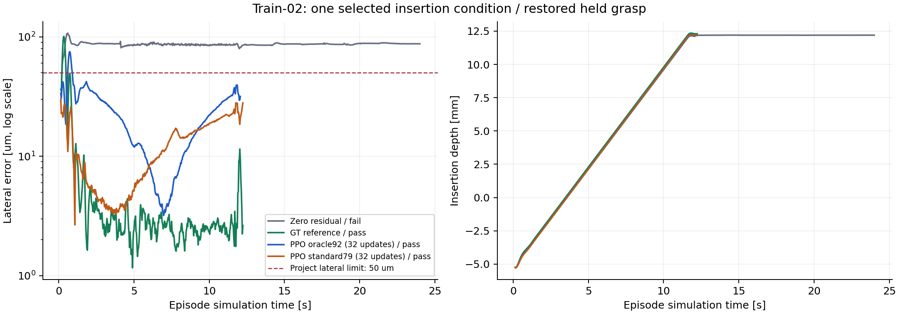

# 고정 train 조건의 PPO 학습 가능성 진단

기준 제어가 실패한 train 조건에서, 표준 관측 PPO가 32회 갱신 뒤 독립 삽입 판정을 통과했다. 이는 한 조건에서 보정 행동을 학습할 수 있다는 결과다. 여러 조건의 성공률 향상이나 일반화는 아직 검증하지 않았다.

후속 [상수·재생 대조](../rj45-frozen-ablation-20261031/README.md)에서는 같은 학습 조건의 상수·재생 보정도 성공했다. 새 보정 오차 네 개에서는 무보정이 4/4 성공하고 PPO·상수·재생은 각각 0/4였다. 아래 기록은 단일 조건의 학습 가능성 근거로 유지하며, 피드백 학습이나 미사용 조건의 개선 근거로 확대하지 않는다.

## 학습 후 물리 평가

| 제어 | 최종 횡오차 | 삽입 깊이 | 종료 시각 | 판정 |
| --- | ---: | ---: | ---: | --- |
| 무보정 기준 | 87.50 µm | 12.194 mm | 24.000 s | timeout 실패 |
| 정답 참조 제어 | 2.63 µm | 12.295 mm | 12.233 s | 성공 |
| 표준 관측 PPO32 | 28.00 µm | 12.163 mm | 12.233 s | 성공 |
| 정답 관측 PPO32 | 31.67 µm | 12.113 mm | 12.067 s | 성공 |

표준 PPO는 초기 결정론적 평가에서 무보정 기준과 같은 87.50 µm 실패를 보였다. 최종 actor의 가중치가 달라졌고, 최종 평가에서는 횡오차와 안정 유지까지 통과했다. [전체 수치](result.json)와 [primary 비교 감사](primary-pair-audit.json)에 원본 report·trace·update 해시를 남겼다. 두 PPO 군 모두 성공했으므로 이번 한 사례로 정답 관측의 이득이나 관측 부족을 결론 내리지 않는다.



## 무엇을 비교했나

왼손이 LAN 어댑터를 지지하고 오른손이 RJ45 플러그를 삽입한다. 물체는 그리퍼 마찰 접촉으로 지지하며, 학습 정책은 INSERT 단계의 오른손 6D 팁 목표 보정만 결정한다. 왼손 지지, 삽입 진행, 단계 전환, 힘에 따른 중단과 후퇴는 고정 스크립트다. 로봇 drive 설정은 몸통 6 + 양팔 14 + 손가락 4의 24 DOF이며, 에셋의 나머지 관절까지 모두 정책으로 제어한 것은 아니다.

- `zero`: 학습 보정이 0인 기준 제어.
- `reference`: 정답 상태로 같은 오른손 보정 한도에서 동작하는 참조 제어기.
- `standard79`: actor 입력 79D, critic 입력 92D.
- `oracle92`: actor와 critic 모두 92D. actor에 추가된 정답 상대 자세·twist 13D는 원인 분리용이다.

표준 actor의 79D에는 시뮬레이션의 추정 상태와 접촉·관절·명령 신호가 들어간다. 실제 RGB 영상 정책이나 실측 센서 입력을 사용한 결과가 아니다. 평가기는 정책과 분리한 시뮬레이터 정답 상태로 성공을 판단한다.

## 조건과 선택 규칙

파지는 `rj45-train-02`, base seed는 `20261128`, 환경 0의 episode 1, 보정 seed는 `66384148`로 고정했다. 물리는 240 Hz, 제어는 30 Hz, 환경은 1개다. 순서가 고정된 세 후보 중 첫 후보에서 무보정 실패와 참조 복구 성공을 확인했으므로 나머지 후보는 실행하지 않았다. [선택 기록](selection.json)과 [원래 프로토콜](protocol-20261128.json)을 보존한다. 이는 어려운 train 사례의 진단이며 무작위 시험의 성공률 분모가 아니다. dev/final은 열지 않았다.

두 PPO 군의 예산은 각각 32 updates × 128 transitions, 합계 4,096 transitions다. 두 군은 각각 32회 갱신을 마쳤다. 초기 actor의 공통 79D 투영, critic92, optimizer와 초기화·학습 RNG의 해시가 두 군에서 일치했다. 소스·bank·에셋도 실행 종료 시 다시 검증했고 primary 감사의 18개 검사를 통과했다. 평가는 초기 결정론적 actor와 사전 지정한 final32 checkpoint를 사용한다. 8·16·24회 checkpoint는 진단 보관용이며 선택하지 않았다. 짧은 실행이므로 수렴이나 충분한 학습량을 뜻하지 않는다.

50 µm는 이 프로젝트가 정한 횡오차 성공 기준이며 RJ45 제조사 규격의 보증값이 아니다. 깊이·방향·파지 유지·금지 접촉·하중·0.4초 안정 유지도 함께 통과해야 한다. 3.78 N 수준의 `force_peak_n`은 그리퍼 접촉 proxy를 포함하므로 삽입축 힘으로 해석하지 않는다.

## 실행 오류와 복구를 어떻게 구분했나

1. 첫 시도는 CPU 수학 라이브러리의 ULP 차이로 bank 형상 재계산 검사가 실패했다. 소스·bank·허용 오차는 바꾸지 않고 CPU 기능 설정을 고정해 전체 eligible 행의 일치를 확인했다. [재현과 범위](compatibility.md)를 별도로 남겼다.
2. 원래 oracle 실행은 32 updates를 마쳤지만, 최종 평가 reset이 PyTorch inference 문맥 밖에서 실행돼 실패했다. [원본 invalid 보고서](oracle92-original-invalid-report.json)와 [32회 갱신 기록](oracle92-original-invalid-updates.jsonl.gz)을 보존한다. native Kit 종료 코드가 0이어도 보고서가 invalid면 배치 실패로 판정한다.
3. 평가 reset·step 전체를 `torch.inference_mode()`로 감쌌다. 물리·보상·행동 범위·판정·seed는 바꾸지 않았다. 수정 소스의 [표준군 실행 및 복구 계약](repair-phase-admission.json)을 실행 전에 고정했다.
4. 원본 final32 checkpoint를 새 학습 없이 평가했을 때 성공했다. [복구 보고서](oracle92-recovered-report.json)는 checkpoint 사후 분석용이다. 원본 실행의 invalid 상태를 바꾸거나 primary 비교·독립 seed 수에 합산하지 않는다.
5. 원본 invalid 보고서에는 전체 초기화 감사 정보가 없어, 수정 소스로 새 oracle32를 한 번 실행하는 [추가 계약](replication-admission.json)을 두 군의 최종 성과 확인 전에 고정했다. Primary 비교는 수정 소스의 standard79와 새 oracle92만 사용한다. [실행 후 검증 규칙](replication-after-run-audit-admission.json)은 해시나 초기화 대조가 실패하면 incomplete로 끝내며 대체 실행을 허용하지 않는다.

## 60 fps 실패·성공 재생

- [무보정 기준 실패 영상](../../media/rj45/oracle-condition/zero-fresh-replay-diagnostic-60fps.mp4): 50 µm를 넘는 횡오차와 안정 유지 0초를 표시한다.
- [표준 PPO32 성공 영상](../../media/rj45/oracle-condition/standard79-fresh-replay-diagnostic-60fps.mp4): 횡오차 기준과 안정 유지 0.4초 통과를 표시한다.
- [영상·프레임·측정값 검증](oracle-fresh-replay-media-manifest.json): 실패 1,454프레임, 성공 748프레임을 원본과 1:1로 내보냈다. 출력은 모두 1,600×900, 60 fps다.

두 영상은 학습·평가 원본 촬영이 아닌, 고정 정책을 새 물리 실행에서 재생한 기록이다. 신규 재생도 각각 실패·성공으로 판정됐다. 원래 평가와 재생의 미세한 수치 차이는 별도로 보존한다. 프레임 보간·홀드 없이 현재 물리 프레임의 형상·횡오차·깊이를 표시하고, 안정 유지 값은 제어 스텝 종료 기록임을 구분한다. 영상의 물리 시계에는 초기 준비 시간이 포함돼 표의 episode 시계보다 약 0.233초 크다. 테이블에 남아 있는 청록색 세로 기둥은 고정 픽업 지그이며, 손 안의 투명 플러그와 구분한다.

후처리는 OpenCV·NumPy·Pillow와 ffmpeg/ffprobe, Noto CJK 폰트가 있는 로컬 환경에서 수행한다. GPU와 Isaac Sim은 필요하지 않다. 이 환경은 기본 Python 3.11 단위 검사 환경과 구분한다.

```bash
cd "$HOME/rby1-assembly-lab"
python3 -m pytest -q checks/test_export_rj45_oracle_media_e2e.py
python3 scripts/export_rj45_oracle_media.py \
  --input-dir artifacts/cloud/rj45-oracle-condition-20261031/fallback/media/completed \
  --media-dir artifacts/replay-export-check/media \
  --evidence-dir artifacts/replay-export-check/evidence
```

기존 출력 파일이 있으면 덮어쓰지 않는다. 원본 MP4는 로컬 보존하며 공개 저장소에는 계보·프레임 측정값과 후처리 영상을 둔다.

## 결과를 재확인하는 방법

원본 trace와 updates는 gzip으로 압축했으며 압축을 푼 SHA-256을 각 보고서와 대조한다. 실제 checkpoint는 용량이 큰 비공개 로컬 산출물에 보존하고 공개 보고서에는 해시를 남긴다. 원래 runner와 수정 runner도 구분해 압축 보관한다.

```bash
cd "$HOME/rby1-assembly-lab"
python3 docs/evidence/rj45-oracle-condition-20261031/audit_primary_pair.py
python3 docs/evidence/rj45-oracle-condition-20261031/plot_results.py
```

그래프 생성에는 matplotlib이 필요하다. 감사 스크립트는 Python 표준 라이브러리만 사용한다. 서버 환경을 재구성할 때는 [Brev 실행 문서](../../brev-run.md)의 고정 버전과 CPU 호환 설정을 적용한다.

## 이 결과로 말할 수 있는 범위

- 같은 train 조건에서 0으로 초기화한 표준 actor의 실패가 학습 후 성공으로 바뀌었다.
- 깊이·방향·하중 기준은 학습 전에도 통과했고, 이번 변화의 핵심은 횡방향 정렬과 안정 유지다.
- 한 가지 고정 보정 오차를 상수 행동으로 상쇄했을 가능성은 아직 배제하지 않았다. 상태에 따른 피드백 학습이나 관측 충분성의 입증은 남아 있다.
- 정답 관측군과의 한 번의 비교로 관측 정보의 필요성이나 알고리즘 우열을 정하지 않는다. 과거 다중 조건 실험의 승격 기준 미달 결과도 유지한다.
- 다음 성능 검증은 정책 선택에 사용하지 않은 보정 조건에서 기준 제어와 paired 비교하고, 여러 학습 seed로 반복하는 것이다. final은 후보 선택을 마친 뒤 한 번 평가한다.

## 실행 종료와 검증

기본 CPU 검사는 771개 테스트·307개 하위 검사를 통과했고, OpenCV·FFmpeg를 사용하는 합성 영상 전체 내보내기는 별도 시스템 Python에서 폰트 검사와 함께 2개 검사를 통과했다. 모든 실행 보고서·trace·weights·영상 원본을 회수해 아카이브 해시를 대조한 뒤, 이번 L40S `pyf1b9s0a`를 정지하고 새 inventory의 `STOPPED`를 확인했다. 이번 작업의 종료 타이머와 프로세스도 남아 있지 않다. [종료 기록](closure.json)에 상태와 범위를 남겼다. 과거 실패 서버의 볼륨은 삭제하지 않았다.
