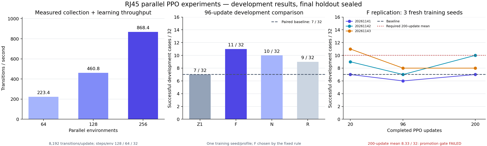

# 병렬 규모와 PPO 개선 비교

4×L40S 인스턴스의 단일 GPU(cuda:0)에서 병렬 환경 수를 비교하고, 네 설정은 GPU별로 병렬 학습했다. 고정 학습률 F가 첫 개발 비교에서 가장 높았으나, 새 학습 seed 세 개로 반복한 200-update 결과는 사전 성능 기준에 못 미쳤다. 최종 평가 seed는 열지 않았다.



## 처리량

| 환경 수 | 환경별 rollout 길이 | 학습 update당 전이 수 | 측정 처리량 |
|---:|---:|---:|---:|
| 64 | 128 | 8,192 | 223.39 전이/초 |
| 128 | 64 | 8,192 | 460.75 전이/초 |
| 256 | 32 | 8,192 | 868.43 전이/초 |

렌더링 없이 같은 update 크기에서 측정했다. 3회 준비 update를 제외하고 5회 학습의 수집·갱신 시간을 사용했다. 환경 수와 환경별 rollout 길이가 함께 바뀌므로 과거 64×128 학습과 성공률을 비교해 순수한 병렬화 효과라고 해석하지 않는다. 이번 네 설정은 모두 선택된 256×32를 사용했다. [벤치마크 원본](benchmark-summary.json), [실행 전 계약](../scale-refinement-protocol.json).

## 같은 조건의 설정 비교

학습 seed 20261104, 개발 seed 20261028, 같은 물리 파지 상태·32개 보정 오차 사례로 평가했다. 각 설정은 96 update, 786,432 전이를 사용했다.

| 설정 | 변경점 | 20 update, 진단용 | 96 update, 선택용 |
|---|---|---:|---:|
| 기준 제어 | 학습 보정 없음 | 7/32 | 7/32 |
| Z1 | 기준 PPO | 7/32 | 7/32 |
| F | Z1에서 학습률만 고정 | 10/32 | 11/32 |
| N | F에서 초기 탐색 표준편차 축소 | 8/32 | 10/32 |
| R | N에서 횡방향 보상 스케일 축소 | 8/32 | 9/32 |

사전에 정한 선택 규칙을 결과에 적용해 F를 후속 후보로 도출했다. F와 N이 후보 자격을 통과했고, 성공 횟수가 높은 F를 골랐다. 동률일 때의 순서는 F→N→R로 정했지만 이번 결과에는 동률이 없었다. [실행기 원본](refinement-summary.json)의 `selection_performed=false`는 보존했다. 실행기가 후보 선택까지 자동 수행했다는 뜻으로 바꾸지 않는다. 단일 학습 seed의 개발 결과이므로 F의 일반화 성능을 확정하는 근거가 아니다.

## F의 새 seed 반복

| 학습 seed | 20 update, 진단용 | 96 update, 진단용 | 200 update, 판정용 |
|---|---:|---:|---:|
| 20261141 | 7/32 | 6/32 | 7/32 |
| 20261142 | 9/32 | 7/32 | 10/32 |
| 20261143 | 11/32 | 8/32 | 8/32 |

각 seed 1,638,400 전이, 총 4,915,200 전이를 학습했다. 판정용 200-update 성공 합계는 25회이며 요구한 30회에 못 미친다. 평균은 8.33/32, 요구 기준은 10/32다. 각 seed 최소 7/32, 무효 episode 0, 금지 접촉 하중 0 조건은 통과했다. [결과 원본](f-followup-summary.json), [독립 검증](independent-audit.json).

기준 제어 대비 평균 성공률 차이는 +4.17%p였다. 학습 seed와 평가 사례를 함께 재표집한 탐색적 95% bootstrap 구간은 −6.25~+14.58%p로 0을 포함한다. 이 구간은 모델 선택에 사용하지 않았다. 세 seed·같은 파지 상태의 개발 검증이며, 성능 향상이나 미사용 파지 상태의 일반화를 입증하지 못했다.

## 실패 해석과 다음 비교

기준 제어 1개와 네 설정의 8개 개발 보고서에서 실패 211개는 모두 시간 제한 종료였다. 종료 시 삽입 깊이와 각도는 기준 안에 있었지만 190개는 횡방향 오차가 50 µm를 넘었다. 나머지 21개도 전체 성공 조건을 연속 0.4초 유지하지 못했다. 이 기록만으로 물리적인 끼임을 원인으로 단정하지 않는다.

50 µm는 시뮬레이터 정답 자세로 계산하는 성공 판정의 횡방향 오차 한계다. 카메라의 측정 정확도나 실물의 조립 공차를 검증한 값은 아니다. 다음 비교는 여러 물리 파지 상태에서 수집한 시연으로 actor를 초기화한 뒤, 같은 PPO 학습량의 대조군과 비교하는 것이다. 데이터 생성·teacher·BC·PPO 각 단계의 입력과 분할을 따로 고정한다. [시연 비교 계약](../../rj45-demonstrations-20261028/protocol.json).

## 재현과 보존 범위

학습 소스는 `63f96e5951c7de4a4a5e804c0584c70721d05e8c`다. 4B 회수 파일 184개와 입력 73개, 후속 F 회수 파일 114개의 SHA를 검증했다. 9개 후속 checkpoint의 payload iteration 19/95/199와 유한한 model·optimizer 상태를 확인했다. 이 폴더에는 원본 요약·독립 감사와 그래프 입력 해시를 보존하며, checkpoint·전체 로그는 별도 회수 묶음에 있다.

`plot.py`는 이 폴더의 JSON만 읽어 PNG·SVG와 `figure-manifest.json`을 생성한다. Matplotlib을 사용할 수 있는 Python에서 실행한다.

```bash
cd "$HOME/rby1-assembly-lab"
python3 docs/evidence/rj45-refinement-20261028/scale-results/plot.py
```
